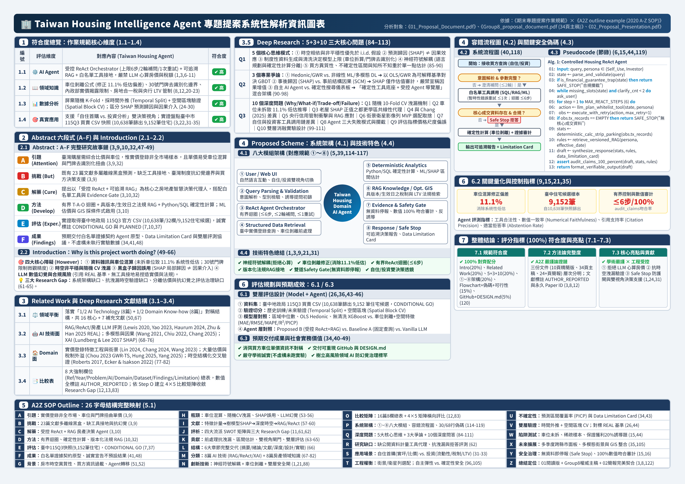

# Taiwan Housing Intelligence Agent — 專題重構與論證資料集 (DIC3_ProjectRefactor)

> **結合實價登錄、空間特徵與可解釋人工智慧之房地產決策代理人**  
> *Controlled ReAct + Versioned RAG + Whitelisted Deterministic Tools + Evidence & Safety Gate*



---

## 📁 專案目錄結構 (Repository Structure)

本專案將專題提案解析、摘要、亮點整理與 Perplexity 查證素材統一封裝於 [`proposal_materials/`](./proposal_materials/) 資料夾中：

```text
DIC3_ProjectRefactor/
├── README.md                                              # 專案總覽與導覽說明（本檔案）
└── proposal_materials/                                    # 專題核心論證與解析素材資料夾
    ├── perplexity_conversation_summary.md                 # Perplexity 對談紀錄與 A–F 論證官方素材整理
    ├── 報告摘要.pdf                                       # 專題報告摘要（A–F 結構與 CONDITIONAL GO 實驗規劃）
    ├── 房地產決策代理人亮點.pdf                           # 專案六大核心亮點與預期交付成果解析
    ├── NBLM期末專題解析.pdf                               # 對照 A-to-Z SOP 與期末作業規範之逐章深度解析
    └── Taiwan_Housing_Agent_A4_landscape.png              # 專題提案系統性解析 A4 橫式資訊圖表 (Infographic)
```

---

## 📄 檔案內容導覽 (File Guide)

| 檔案名稱 | 類型 | 內容重點說明 |
| :--- | :---: | :--- |
| [**`perplexity_conversation_summary.md`**](./proposal_materials/perplexity_conversation_summary.md) | Markdown | 彙整內政部地政司官方車位／面積拆算案例（37.5 萬 vs. 56 萬／坪，差距達 49%）、臺中市 110 年後買賣案件資料集定義，以及 ReAct、RAG、Evidence Gate 最新文獻依據，對應 A–F 六段論證結構。 |
| [**`報告摘要.pdf`**](./proposal_materials/報告摘要.pdf) | PDF | 濃縮本專題研究動機、23 篇文獻缺口（16 篇核心 + 7 篇補充）、ReAct + RAG + Evidence Gate 系統方法，以及臺中市 115 年第 3 季官方 CSV 快照（10,638 筆原始資料、9,152 筆住宅候選）之實驗設計。 |
| [**`房地產決策代理人亮點.pdf`**](./proposal_materials/房地產決策代理人亮點.pdf) | PDF | 系統性剖析六大技術與領域亮點：(1) 神經符號解耦（拒絕 LLM 心算房價）、(2) 知所不知與 Safe Stop 安全防護閘、(3) 車位剝離（消除 11.1% 系統性低估）與去識別化門牌處理、(4) 抗洩漏之時間外推與空間區塊驗證、(5) 區分 SHAP 預測歸因與因果效應（自住／投資雙視角）、(6) 資料可行性落實（`CONDITIONAL GO`）。 |
| [**`NBLM期末專題解析.pdf`**](./proposal_materials/NBLM期末專題解析.pdf) | PDF | 依據《期末專題提案作業規範》與《2020 A-to-Z SOP》框架，深度剖析三份交付文件（閱讀版、34 頁主稿、簡報投影片）之對齊程度，涵蓋 `5+3+10` 深度研究、①～⑧ 八大模組架構與 30/68 行具行號之安全控制 Pseudocode。 |
| [**`Taiwan_Housing_Agent_A4_landscape.png`**](./proposal_materials/Taiwan_Housing_Agent_A4_landscape.png) | PNG | 一頁式高密度視覺化資訊圖表，完整呈現規範符合度、A–F 摘要故事鏈、1/2 AI + 1/2 Domain 文獻配置、5+3+10 核心思維、①～⑧ 系統架構、容錯流程圖與 A-to-Z 26 字母映射表。 |

---

## 🎯 核心論證與系統設計摘要 (A–F Overview)

1. **A. Attention Getter（實價登錄非母體＆單價口徑敏感）**
   * 內政部實價登錄為「申報登錄」之去識別化成交資料，並非全市場母體；未篩選建物型態時易混入店面或車位。
   * 依內政部地政司官方案例，同一筆 **總價 3,000 萬元、總面積 80 坪（含車位 200 萬、10 坪）** 的交易，因是否扣除車位、共同使用部分（公設）與附屬建物，單價可由 **37.5 萬元／坪** 擴大至 **56 萬元／坪**（差距約 **49%**）。
2. **B. But（黑盒子估價與單一數字風險）**
   * 既有房價模型多停留於離線黑盒子點估計，忽略臺灣實價登錄車位混算（直接相除會造成約 **11.1%** 系統性低估）與 30 號門牌區間去識別化限制。
   * 通用 LLM 缺乏結構化計算工具與外部證據約束時，極易在房價數值與法規條文上產生幻覺（Hallucination）。
3. **C. Cure（ReAct + RAG + 白名單工具 + Evidence Gate）**
   * **神經符號解耦**：由有界 **ReAct** 迴圈（最多 6 步、最多 2 輪補問、單次重試）負責規劃與調度，**嚴禁 LLM 自行心算房價、面積或稅額**，所有數值交由白名單 Python/SQL 確定性工具計算。
   * **版本化 RAG 與 Evidence Gate**：檢索具生效日期的官方法規與欄位定義；若缺乏核心成交資料或遇財務保證誘導提問（如「保證兩年穩賺 20%」），強制觸發 **Safe Stop** 拒答或降級為資料限制說明。
4. **D. Development（把「口徑」變成三層可稽核契約）**
   * 將內政部官方車位拆算規則寫入確定性工具，並輸出三層契約：**資料契約**（版本、快照日期、篩選規則、缺失率）、**計算契約**（單價公式、車位／公設處理、樣本數）與 **決策契約**（自住／投資雙視角、價格區間、法規限制與不確定性）。
5. **E. Experiments（臺中市官方快照與抗洩漏評測）**
   * 基於臺中市政府地政局「110 年後買賣案件」之 **115 年第 3 季官方 CSV 快照（10,638 筆記錄、32 欄，篩選出 9,152 筆住宅候選）**，目前誠實標註為 `CONDITIONAL GO`。
   * 屏棄隨機 K-Fold，採用 **時間外推切分（Temporal Out-of-Sample Split）**、**空間行政區塊驗證（Spatial Block CV）** 與 **REAL 基準評測**（未執行項目誠實標記為 `PLANNED`／`NOT RUN`）。
6. **F. Findings（可審計的決策支援，而非宣稱消除所有幻覺）**
   * 交付具備白名單工具、Evidence Gate 與 Data Limitation Card 的 Agent 原型，建立**失敗可見、證據可查、計算可重現**的高風險領域 AI 治理標竿。
